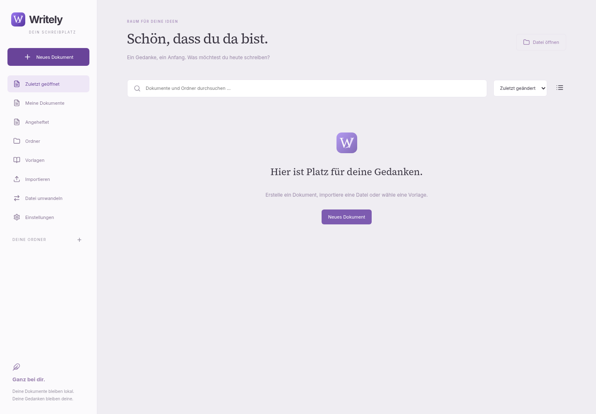

# Writely

Eine lokale Schreibapp mit deutscher Oberfläche. Der veröffentlichte Windows-Stand ist **0.4.0-alpha.1**. Dieser Entwicklungsbranch **0.5.0-prototype.1** ergänzt einen gemeinsamen Dokumentkern, einen tatsächlich verschlüsselten Tresor und einen Android-Prototyp. Er ist noch keine vollständige plattformübergreifende Version.

[Entwicklungsplan und Ausgangsanalyse](docs/CROSS-PLATFORM-PLAN.md) · [Sicherheitsmodell und Dateiformat](docs/SECURITY-MODEL.md) · [Android, Builds und Funktionsstand](docs/ANDROID-PROTOTYPE.md).

Windows: Im Startbildschirm **Verschlüsselter Tresor · Vorschau** öffnen. Der Tresor schützt seinen eigenen Arbeitsbereich einschließlich Ordnern, Papierkorb und Versionen. Bestehende Windows-Dokumente werden dadurch nicht nachträglich verschlüsselt. Kein Release und keine Play-Store-Veröffentlichung erfolgen automatisch.

Weiterhin verfügbar: Unter **Einstellungen → Fenster & Bildschirme** zwischen Fenster, maximiert und Vollbild wechseln und Writely auf einen anderen Bildschirm verschieben. Zurück zum Fenster: `Strg+Umschalt+F11`.

## Download

Für die veröffentlichte Version 0.4.0-alpha.1 im [GitHub-Release](https://github.com/lavender1510/Writely/releases) das Windows-Setup ausführen oder das portable ZIP vollständig entpacken und Writely.exe starten. Node.js und Internet sind für die installierte App nicht erforderlich. Die Vorabversion ist nicht signiert.

## Funktionen

Rich Text mit Überschriften, Listen, Tabellen, Bildern und Links; globale Styles; Fokus-/Darkmodus; Befehlspalette; Suchen/Ersetzen; Auto-Save/Recovery und lokale Versionen. Dazu Bibliothek mit Ordnern, Suche, Anheften, Vorlagen, Cover und Themes.

Import/Export: .writely, DOCX, Text, Markdown, HTML und grundlegendes ODT/RTF/EPUB. DOCX und ODT exportieren Abschnittslayouts, Tabellen und Bilder. PDF-Export und Druckvorschau verwenden Chromium mit echten gemischten Seitengrößen. Pandoc ist im Windows-Paket samt Lizenz und korrespondierendem Quellcode enthalten. Konvertierung erfolgt lokal.

[Layout-Update und Entwicklungsstand](docs/LAYOUT.md): Formate A3/A4/A5, Letter, Legal, Tabloid, Executive und eigene Maße; individuelle Ränder, Spalten, Kopf-/Fußzeilen und Seitennummern. Seitenbereiche lassen sich einfügen, kopieren, löschen und umordnen. Die Schreibansicht bleibt kontinuierlich; automatische Druckseiten zeigt die PDF-Vorschau.

**Strg+S aktualisiert die gewählte Datei.** Automatische Wiederherstellung und Bibliothek sind zusätzliche lokale Sicherungen.

## Grenzen und Planung

[Release-Hinweise](docs/RELEASE-NOTES.md) beschreiben den tatsächlichen Umfang. Vollständige Office-Treue, PDF-Import/OCR, Kommentare, automatische Editorpagination, Verzeichnis-Seitenzahlen und Echtzeit-Kollaboration sind weitere Ausbaustufen. [Produktkonzept und Architektur](docs/KONZEPT.md), [Formatplanung](docs/FORMATE.md).

Dokumente verwenden jetzt Schema 2; alte Schema-1-Dateien bleiben durch eine explizite Migration lesbar. Ältere Writely-Versionen können Schema 2 nicht öffnen. Eigenständige Explorer-Dateien werden durch die Migration beim Lesen nicht überschrieben.

## Entwicklung

Node 24 und npm. `npm ci`, `npm run build`, `npm run desktop`. Browser-Vorschau: `npm run dev`.

Prüfungen: `npm test`, `npm run test:e2e`, `npm run test:desktop`. Konvertertests brauchen Pandoc 3.13 als `WRITELY_PANDOC` oder unter `.tools/pandoc`; Windows-CI richtet die gebündelte Version mit `node scripts/prepare-pandoc.cjs` ein.

[Drittanbieterhinweise](THIRD_PARTY_NOTICES.md). Für Writely-eigenen Code ist noch keine gesonderte Open-Source-Lizenz festgelegt.
