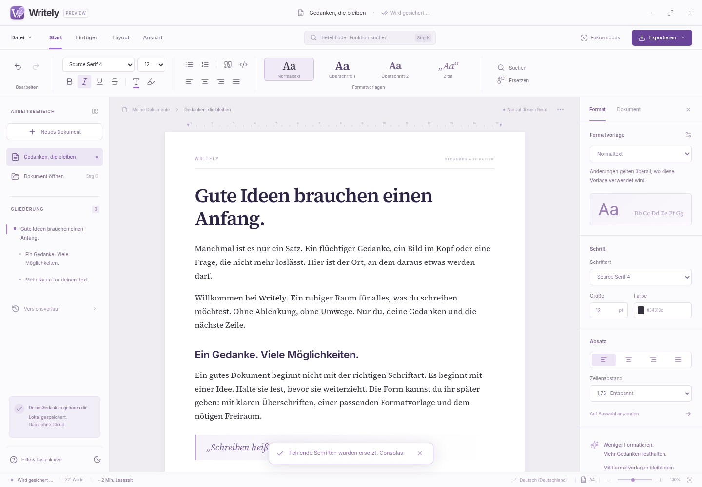

# Writely

Eine lokale Schreibapp mit deutscher Oberfläche für Windows 10/11. **v0.1.0-alpha.1 ist eine erste Vorabversion**, keine vollständige Alternative zu Microsoft Word oder LibreOffice. Sie verbindet einen echten Rich-Text-Editor mit Dateispeicherung, Wiederherstellung und grundlegenden Dokumentexporten.



## Windows-Version starten

1. Im [GitHub-Bereich „Releases“](https://github.com/lavender1510/Writely/releases) die Datei `Writely-0.1.0-alpha.1-Windows-x64.zip` herunterladen.
2. **Das gesamte ZIP in einen Ordner entpacken.** Die EXE nicht direkt aus dem ZIP starten und nicht allein aus dem Ordner verschieben; sie benötigt die mitgelieferten Ressourcen.
3. Im entpackten Ordner `Writely.exe` ausführen. Node.js und ein Entwicklungsserver sind dafür nicht erforderlich.
4. Mit `Strg+N` ein Dokument bzw. eine Vorlage wählen. Mit `Strg+S` eine eigene `.writely`-Datei speichern.

Das Paket ist für Windows x64 bestimmt und nicht signiert. Ein interaktiver Windows-10/11-Test und Leistungsbenchmarks sind noch ausstehend. Die Entwicklung und die zunächst verfügbaren Desktop-/Browserprüfungen erfolgen unter Linux; ein erfolgreiches Paketieren beweist allein keine vollständige Windows-Kompatibilität.

## Was bereits funktioniert

- Rich Text mit Undo/Redo, Überschriften 1–6, Fett/Kursiv/Unterstrichen, Durchstreichen, Hervorheben, Farbe, Schriftfamilie/-größe, Ausrichtung, Listen, Zitaten und Codeblöcken.
- Einfache Tabellen, lokale PNG-/JPEG-/WEBP-/GIF-Bilder und Links.
- Bearbeitbare benannte Formatvorlagen: Änderungen an Schrift, Farbe und Zeilenabstand aktualisieren die zugehörigen Elemente im Dokument. Direkte Textformatierung kann diese Regeln übersteuern.
- Überschriften-Navigator, Fokusmodus, Typewriter-Scrolling, helles/dunkles Design, Zoom und Schreibstatistiken.
- Befehlspalette, Suchen/Ersetzen mit optionalen regulären Ausdrücken und Vorlagen für Brief, Bericht, Protokoll und Roman.
- Lokales `.writely`-Format, Auto-Sicherung zur Wiederherstellung und eine einfache lokale Historie mit bis zu 30 Snapshots insgesamt.
- Import von DOCX, TXT, Markdown und HTML; Export als DOCX, PDF, TXT, Markdown und HTML im Desktop-Build.
- Systemschriftarten-Ermittlung im Desktop-Build; Inter und Source Serif 4 werden mit ihren OFL-Lizenzen lokal mitgeliefert.

Die App benötigt zum Schreiben, Speichern und Exportieren keine Internetverbindung. Ausgehende Dokument-Netzwerkanfragen sind im Produktionsrenderer gesperrt. Externe Bilder werden nicht automatisch aus dem Internet nachgeladen.

## Speichern und Wiederherstellung

Die automatische Sicherung schreibt nach einer kurzen Eingabepause einen Wiederherstellungsstand im lokalen App-Datenordner. **Sie aktualisiert nicht automatisch eine selbst gewählte `.writely`-Datei.** Dafür weiterhin `Strg+S` verwenden. Ein Import wird beim Speichern als Writely-Datei abgelegt; die ursprüngliche DOCX-/HTML-/Textdatei wird dadurch nicht überschrieben.

Beim nächsten Start wird der vorhandene Wiederherstellungsstand geladen. Im Versionsverlauf können ältere lokale Snapshots geöffnet werden. Die Historie ist begrenzt und wird von allen Dokumenten derselben App-Installation geteilt; sie ersetzt kein eigenes Dateibackup. Bei abruptem Prozess-/Stromausfall können Eingaben seit der letzten erfolgreich abgeschlossenen Sicherung fehlen.

## Bekannte Grenzen

- DOCX-Import/-Export ist grundlegend. Seitenlayout, Kopf-/Fußzeilen, Fußnoten, Kommentare und Änderungsverfolgung bleiben nicht originalgetreu erhalten. Importwarnungen beachten und Exporte im Zielprogramm prüfen.
- PDF wird im Desktop-Build tatsächlich erzeugt. Im Editor gibt es eine fortlaufende Dokumentfläche; echte Druckseiten entstehen erst beim PDF-Export. Eine PDF/A-/PDF/UA-, CMYK- oder vollständige Schrifteinbettungszusage gibt es noch nicht.
- Das eingefügte Inhaltsverzeichnis ist eine Textaufnahme der aktuellen Überschriften und aktualisiert sich nicht automatisch.
- ODT, RTF, EPUB, das alte DOC-Format und PDF-Import sind noch nicht implementiert.
- Offline-Rechtschreibwörterbücher, Benutzerwörterbuch, Thesaurus, Silbentrennung, deutsche AutoKorrektur, echte Fuß-/Endnoten, Multi-Cursor und rechteckige Auswahl fehlen noch. Die Renderer-Rechtschreibeinstellung allein garantiert keine verfügbare Offline-Prüfung Deutsch/Englisch.
- Fontimport/-verwaltung, vollständiger Style-Editor, präzise Druckpagination, Kopf-/Fußzeilen, Abschnittslayout, Kommentare und Änderungsverfolgung folgen später.
- Suche arbeitet innerhalb einzelner Textabschnitte des Editorbaums; Treffer über Formatierungs-/Absatzgrenzen und komplexe Regex-Ersetzung sind begrenzt.
- Keine Cloud-Synchronisation, Kollaboration oder automatischen Updates. Ein Start unter zwei Sekunden und flüssiges Bearbeiten hunderter Seiten sind noch keine gemessenen Eigenschaften dieses Releases.

Details: [Release-Hinweise](docs/RELEASE-NOTES.md), [Formatmatrix](docs/FORMATE.md), [Produktvision, Architektur und Roadmap](docs/KONZEPT.md).

## Tastenkürzel

| Kürzel | Aktion |
| --- | --- |
| Strg+N / Strg+O / Strg+S | Neu / Öffnen / Speichern |
| Strg+K | Befehlspalette |
| Strg+P | Exportdialog |
| Strg+F / Strg+H | Suchen und Ersetzen |
| Strg+Z / Strg+Y | Rückgängig / Wiederholen |
| Strg+B / Strg+I / Strg+U | Fett / Kursiv / Unterstrichen |
| Strg+Alt+1 … 6 | Überschriftenebene |
| F11 / Esc | Fokusmodus / Dialog oder Fokusmodus verlassen |

## Entwicklung

Voraussetzung: aktuelles Node.js, empfohlen Node 24 LTS oder neuer, und npm.

```sh
npm ci
npm run build
npm run desktop
```

Browser-Vorschau:

```sh
npm run dev
```

Die Browser-Vorschau verwendet Browser-Speicher und Downloads. Native Dateidialoge, DOCX-Konvertierung, PDF-Export und vollständige Systemfont-Ermittlung gehören zum Desktop-Build. Der Entwicklungsbrowser ist keine installierte Windows-App.

Prüf- und Paketierbefehle:

```sh
npm run typecheck
npm test
npm run test:e2e
npm run package:win
```

Für Browserprüfungen kann vorher `npx playwright install chromium` erforderlich sein. Der Desktop-Smoke-Test (`npm run test:desktop`) startet unter Linux mit dem Headless-Backend von Chromium; unter Windows prüft er die echte Windows-Hülle. Der GitHub-Workflow führt Build, Komponenten- und Desktopprüfungen auf einem Windows-Runner aus. Der Windows-Build entsteht in `release/`.

## Komponenten und Lizenzen

Electron, React, TypeScript und Tiptap/ProseMirror bilden die Grundlage. DOCX wird mit Mammoth importiert und mit `docx` exportiert; PDF verwendet Chromium. Die tatsächlich installierten Abhängigkeiten sind im Lockfile festgehalten.

[Drittanbieterhinweise](THIRD_PARTY_NOTICES.md) und die [mitgelieferten Lizenztexte](licenses/) benennen die verwendeten Komponenten. Für Writely-eigenen Produktcode wurde noch keine gesonderte Open-Source-Lizenz festgelegt. Die Lizenzen der Drittanbieter gelten für deren jeweilige Bestandteile.
